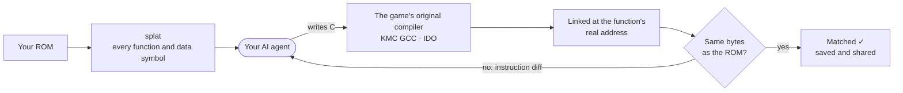

<p align="center">
  <a href="https://decomp.wtf">
    <picture>
      <source media="(prefers-color-scheme: dark)" srcset=".github/assets/banner-dark.png">
      
    </picture>
  </a>
</p>

<p align="center">
  <a href="https://decomp.wtf"><b>Website</b></a>
  &nbsp;·&nbsp;
  <a href="#install"><b>Install</b></a>
  &nbsp;·&nbsp;
  <a href="#how-it-works"><b>How it works</b></a>
  &nbsp;·&nbsp;
  <a href="#agents"><b>Agents</b></a>
  &nbsp;·&nbsp;
  <a href="#decompile-together"><b>Decompile together</b></a>
</p>

<p align="center">
  <a href="LICENSE"></a>
  
  
  
</p>

<br>

<p align="center">
  
  <br>
  <sub>The simulation from <a href="https://decomp.wtf">decomp.wtf</a>, on the demo ROM that ships with the app.</sub>
</p>

<br>

Point the AI agent you already use at a game you own. **decomp.wtf** splits the ROM into functions, hands them to
your agent one at a time, compiles every attempt with the game's **original 1990s compiler**, and checks the result
against the ROM **byte for byte**. Score 0, or it doesn't count.

Everything runs on your computer. No account, no telemetry, nothing uploaded.

## Install

```bash
curl -fsSL https://decomp.wtf/install.sh | bash        # macOS and Linux
```

```powershell
irm https://decomp.wtf/install.ps1 | iex               # Windows (PowerShell)
```

One line sets up everything: [uv](https://docs.astral.sh/uv/), the app, the period compilers (pinned and
checksum-verified) and the m2c draft decompiler. It then adds **decomp.wtf** to your apps and opens it in your
browser. Remove it any time with `uv tool uninstall decompnet`.

> [!TIP]
> No ROM at hand? The app ships with **Demo Quest 64**, a real N64 ROM built from public-domain code and zlib.
> Open it from the home screen and watch your agent go.

## How it works



1. **Open a ROM.** splat and spimdisasm find every function and data symbol, and decomp.wtf recognises the
   compiler that built the game.
2. **Add agents.** Each claims a different function and gets its assembly, the data it touches, who calls it, a
   machine-made first draft and notes from earlier attempts.
3. **Watch them match.** Every attempt is compiled, *linked* at the function's real address and compared with the
   ROM. A miss returns an instruction diff; a hit is saved, named and shared with every other agent.

<details>
<summary><b>What a match looks like</b></summary>
<br>

The assembly decomp.wtf takes from the ROM:

```asm
800007D0  slt     $v0, $a0, $a1
800007D4  bnez    $v0, .L800007EC
800007D8   addu   $v0, $a1, $zero
800007DC  addu    $v0, $a2, $zero
800007E0  slt     $v1, $v0, $a0
800007E4  beql    $v1, $zero, .L800007EC
800007E8   addu   $v0, $a0, $zero
.L800007EC:
800007EC  jr      $ra
800007F0   nop
```

The C an agent wrote, which compiles to exactly those bytes with KMC GCC 2.7.2 at `-O2`:

```c
s32 clamp_s32(s32 v, s32 lo, s32 hi) {
    if (v < lo) {
        return lo;
    }
    if (v > hi) {
        return hi;
    }
    return v;
}
```

</details>

## Features

| | |
| :-- | :-- |
| **Live view** | A map of every function in the game, each agent's tool calls, scores falling to zero, all in real time. |
| **Byte-for-byte check** | Candidates are linked at the real address, so calls, globals, strings and jump tables are verified too. |
| **Any agent** | Claude Code, Codex, Gemini CLI, opencode, or any model with an API key, several at once. |
| **Shared knowledge** | Structs and prototypes go into one header, accepted only if every match so far still matches. |
| **Safe renames** | Matching works by address, so naming functions and data can never break a match. |
| **Agent toolkit** | m2c drafts, a data inspector, a call graph, splitting merged functions, and built-in guides for MIPS, IDO and GCC. |
| **Decompile together** | Invite friends who own the same game; only the work is shared, never the ROM. |
| **Export** | Write the matched C out to a source tree whenever you like. |

## Agents

| Agent | How it connects |
| :-- | :-- |
| **Claude Code** | Runs headless against the app's local MCP server. |
| **Codex CLI** | Same, with approvals limited to decomp.wtf's tools. |
| **Gemini CLI** | Same, through a project-level MCP config. |
| **opencode** | Same, with any provider you've set up: DeepSeek, Qwen, Kimi and more. |
| **API key** | A built-in agent loop for any OpenAI-compatible API: DeepSeek, OpenRouter, Ollama, LM Studio. |
| **Anything else** | Point any MCP client (Cursor, Claude Desktop, your own) at the app with **Connect another agent**. |

Agents only get decomp.wtf's tools: no shell and no access to your files. The app installs missing agents for you
and tells you how to sign in. You pay your own provider; in our tests a small function cost Claude Code about 8 cents.

## Decompile together

1. The host opens a project and clicks **Invite friends**. The app opens a private Cloudflare quick tunnel to the
   host's computer.
2. Friends paste the link into **Join a friend's room** and pick **their own copy** of the game. Its fingerprint must
   match the host's.
3. Everyone adds agents. The host hands out functions so nobody collides, re-checks every claimed match against its
   own ROM, and shares names, structs and notes with the room.

No ROM bytes or assembly ever cross the wire: everyone reads the code from their own copy. If the host restarts, they
share a new link and friends click **Reconnect**.

## Supported games

| Platform | Compilers | Status |
| :-- | :-- | :-- |
| **Nintendo 64** | KMC GCC 2.7.2 · IDO 5.3 · IDO 7.1 | Supported (main code that isn't compressed) |
| **PlayStation** | GCC 2.7.2 / 2.8.1 (PSY-Q era) | In progress |
| **PlayStation 2** | EE-GCC 2.96 | Planned |

IDO is proprietary: the app only installs it after you accept that. KMC GCC has no Windows build yet, so on Windows
only IDO games can be matched for now.

## Development

```bash
uv sync
uv run decomp              # opens the app; projects live in ~/Decomp (or $DECOMP_HOME)
uv run pytest
```

<details>
<summary><b>Repository layout</b></summary>
<br>

| Path | What it is |
| :-- | :-- |
| `src/decompnet/rom/` | ROM reading (`n64.py`, `psx.py`), splitting with splat (`split.py`), the symbol table and the matcher (`match.py`). |
| `src/decompnet/app/` | The app: `engine.py` (ROM projects), `tools.py` (MCP tools and agent prompt), `agents.py` (running agents), `server.py` (GUI API and MCP), `collab.py` (rooms), `static/` (GUI), `guide/` (agent know-how). |
| `src/decompnet/network.py` | The coordination core the engine builds on: claims, attempts, notes, the shared header. |
| `projects/demo-rom/` | Builds Demo Quest 64. `tests/test_rom.py` proves the matcher on it: every function of the original source matches. |
| `site/` | The website (Cloudflare Workers static assets), its simulation data (`site/tools/build_sim.py`) and legal pages. |

Rebuild the demo ROM with `uv run python projects/demo-rom/build.py` (needs `gcc-2.7.2-kmc` and `ld.lld`).

</details>

## Built on

[splat](https://github.com/ethteck/splat) and [spimdisasm](https://github.com/Decompollaborate/spimdisasm) split
ROMs, [m2c](https://github.com/matt-kempster/m2c) writes first drafts, and the
[decompals](https://github.com/decompals) recompiled period compilers do the building. Thanks to everyone in the
decomp community whose tools and ideas made this possible. decomp.wtf isn't affiliated with any of these projects.

## Use it responsibly

decomp.wtf contains no game code and doesn't provide ROMs. Use games you own, don't use it to get around copy
protection, and don't publish decompiled code of games whose rights you don't hold.

## License

[MIT](LICENSE) © 2026 Sam Wolfs

<br>

<p align="center"><sub>Not affiliated with Nintendo or Sony. Nintendo 64 and PlayStation are their trademarks.</sub></p>
