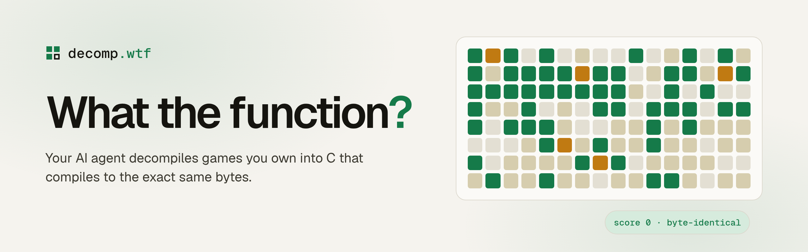
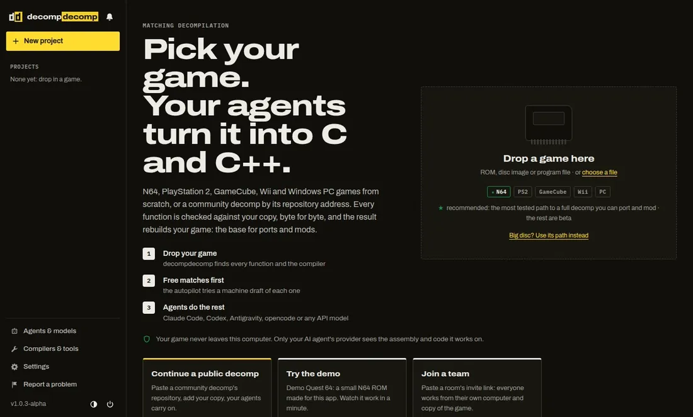
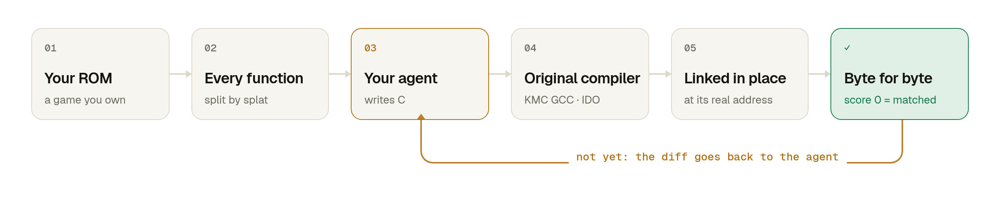

<p align="center">
  <a href="https://decomp.wtf">
    <picture>
      <source media="(prefers-color-scheme: dark)" srcset=".github/assets/banner-dark.png">
      
    </picture>
  </a>
</p>

<p align="center">
  <a href="https://decomp.wtf"><b>Website</b></a>
  &nbsp;·&nbsp;
  <a href="#install"><b>Install</b></a>
  &nbsp;·&nbsp;
  <a href="#how-it-works"><b>How it works</b></a>
  &nbsp;·&nbsp;
  <a href="#continue-a-public-decomp"><b>Public decomps</b></a>
  &nbsp;·&nbsp;
  <a href="#agents"><b>Agents</b></a>
  &nbsp;·&nbsp;
  <a href="#decompile-together"><b>Decompile together</b></a>
</p>

<p align="center">
  <a href="LICENSE"></a>
  
  
  
</p>

<br>

<p align="center">
  
  <br>
  <sub>The simulation from <a href="https://decomp.wtf">decomp.wtf</a>, on the demo ROM that ships with the app.</sub>
</p>

<br>

Point the AI agent you already use at a game you own. **decomp.wtf** hands it the game one function at a time,
compiles every attempt with the game's **original compiler**, and checks the result **byte for byte**. Score 0, or
it doesn't count. There are two ways in:

- **Start from scratch.** Drop in a game for N64, PlayStation 1 or 2, GameCube, Wii, Game Boy Advance or DS: a
  ROM, a disc image or the program file. decomp.wtf finds every function and your agents take it from there. The
  result is a project that rebuilds your game byte for byte: the base for ports and mods.
- **Continue a public decomp.** Pick one of the [245 projects on decomp.dev](https://decomp.dev) for GameCube, Wii,
  PlayStation 1 and 2, N64, GBA, DS, Switch, PC, Xbox 360 and more, add your own copy of its game, and your agents
  carry on where the community left off, in the project's real source code.

Everything runs on your computer. No account, no telemetry, nothing uploaded.

## Install

**macOS and Linux**

```
curl -fsSL https://decomp.wtf/install.sh | bash
```

**Windows** (PowerShell)

```
irm https://decomp.wtf/install.ps1 | iex
```

One line sets up everything: [uv](https://docs.astral.sh/uv/), the app, the period compilers (pinned and
checksum-verified) and the m2c draft decompiler. It then adds **decomp.wtf** to your apps and opens it in your
browser. Remove it any time with `uv tool uninstall decompnet`.

> [!TIP]
> No ROM at hand? The app ships with **Demo Quest 64**, a real N64 ROM built from public-domain code and zlib.
> Open it from the home screen and watch your agent go.

## How it works

<p align="center">
  <picture>
    <source media="(prefers-color-scheme: dark)" srcset=".github/assets/how-dark.png">
    
  </picture>
</p>

1. **Open a ROM.** splat and spimdisasm find every function and data symbol, and decomp.wtf recognises the
   compiler that built the game.
2. **Add agents.** Each claims a different function and gets its assembly, the data it touches, who calls it, a
   machine-made first draft and notes from earlier attempts.
3. **Watch them match.** Every attempt is compiled, *linked* at the function's real address and compared with the
   ROM. A miss returns an instruction diff; a hit is saved, named and shared with every other agent.

<details>
<summary><b>What a match looks like</b></summary>
<br>

The assembly decomp.wtf takes from the ROM:

```asm
800007D0  slt     $v0, $a0, $a1
800007D4  bnez    $v0, .L800007EC
800007D8   addu   $v0, $a1, $zero
800007DC  addu    $v0, $a2, $zero
800007E0  slt     $v1, $v0, $a0
800007E4  beql    $v1, $zero, .L800007EC
800007E8   addu   $v0, $a0, $zero
.L800007EC:
800007EC  jr      $ra
800007F0   nop
```

The C an agent wrote, which compiles to exactly those bytes with KMC GCC 2.7.2 at `-O2`:

```c
s32 clamp_s32(s32 v, s32 lo, s32 hi) {
    if (v < lo) {
        return lo;
    }
    if (v > hi) {
        return hi;
    }
    return v;
}
```

</details>

## Continue a public decomp

Most games people decompile already have a community project with its build set up and part of the code done.
decomp.wtf plugs your agents into them as they are:

1. **Browse** the decomp.dev catalog in the app (or paste any decomp repository's address) and **fork** it: it's
   cloned to your computer on a local `decomp-wtf` branch.
2. **Add your copy of the game.** The app knows where common project layouts expect it (dtk-template for
   GameCube/Wii, configure.py + ninja, splat + make) and runs the project's own setup. Anything else you set up
   by its README, and decomp.wtf picks it up once it builds.
3. **Add agents.** Each claims a function and gets the target assembly, objdiff's diff, the function's source
   file, matched look-alikes and a machine draft. Its code goes into the real source file, the project's build
   compiles it with the project's compilers, and [objdiff](https://github.com/encounter/objdiff) judges it.
4. **Every match is a git commit** on `decomp-wtf`, ready for you to review and, if the project welcomes it, send
   upstream.

Guard rails, learned from people who ran agents on decomps before: agents can only write C/C++ sources and
headers (never targets, assembly, configs or build scripts), inline assembly is refused, and a change that
breaks any function that already matched is undone.

## Features

| Feature | What you get |
| :-- | :-- |
| **Live view** | A map of every function in the game, each agent's tool calls, scores falling to zero, all in real time. |
| **Byte-for-byte check** | Candidates are linked at the real address, so calls, globals, strings and jump tables are verified too. |
| **Any agent** | Claude Code, Codex, Gemini CLI, opencode, or any model with an API key, several at once. |
| **Shared knowledge** | Structs and prototypes go into one header, accepted only if every match so far still matches. |
| **Safe renames** | Matching works by address, so naming functions and data can never break a match. |
| **Public decomps** | Fork any of 245 community projects from decomp.dev and keep going with your agents, judged by objdiff. |
| **Look-alikes** | `find_similar` spots copy-pasted and inlined code across the whole game and starts agents from what already matches. |
| **Drafts** | m2c for MIPS, PowerPC and ARM; optional Ghidra for x86, AArch64 and everything else. |
| **Agent toolkit** | A data inspector, a call graph, splitting merged functions, and guides for MIPS, PowerPC, ARM, x86, AArch64, IDO, GCC, Metrowerks, agbcc, PSY-Q, C++ and objdiff. |
| **Decompile together** | Invite friends who own the same game; only the work is shared, never the ROM. |
| **Rebuildable export** | A decomp project that rebuilds your game byte for byte, ready for ports and mods and for any other tool or agent. |
| **Every major disc format** | ROMs, PlayStation discs, GameCube and Wii discs (ISO, GCM, RVZ, WIA, WBFS, CISO, GCZ) and program files, streamed from disk. |

## Agents

| Agent | How it connects |
| :-- | :-- |
| **Claude Code** | Runs headless against the app's local MCP server. |
| **Codex CLI** | Same, with approvals limited to decomp.wtf's tools. |
| **Gemini CLI** | Same, through a project-level MCP config. |
| **opencode** | Same, with any provider you've set up: DeepSeek, Qwen, Kimi and more. |
| **API key** | A built-in agent loop for any OpenAI-compatible API: DeepSeek, OpenRouter, Ollama, LM Studio. |
| **Anything else** | Point any MCP client (Cursor, Claude Desktop, your own) at the app with **Connect another agent**. |

Agents only get decomp.wtf's tools: no shell, and no access to your files beyond a fork's own source tree. The app installs missing agents for you
and tells you how to sign in. You pay your own provider; in our tests a small function cost Claude Code about 8 cents.

## Decompile together

1. The host opens a project and clicks **Invite friends**. The app opens a private Cloudflare quick tunnel to the
   host's computer.
2. Friends paste the link into **Join a friend's room** and pick **their own copy** of the game. Its fingerprint must
   match the host's.
3. Everyone adds agents. The host hands out functions so nobody collides, re-checks every claimed match against its
   own ROM, and shares names, structs and notes with the room.

No ROM bytes or assembly ever cross the wire: everyone reads the code from their own copy. If the host restarts, they
share a new link and friends click **Reconnect**.

## Platforms

| Platform | From scratch | Compilers | Rebuildable project | Public decomps |
| :-- | :-- | :-- | :-- | :-- |
| **Nintendo 64** | ✓ ROM | KMC GCC 2.7.2 · IDO 5.3 / 7.1 | ✓ export | ✓ |
| **PlayStation** | ✓ disc or EXE | GCC 2.7.2 / 2.8.1 (PSY-Q era) | ✓ export | ✓ |
| **PlayStation 2** | ✓ disc or ELF | EE-GCC 2.96 | ✓ export | ✓ |
| **GameCube · Wii** | ✓ disc (ISO, RVZ, WBFS…) or DOL | CodeWarrior GC 1.0 – Wii 1.7 | ✓ dtk-template | ✓ |
| **Game Boy Advance** | ✓ ROM | agbcc | ✓ export | ✓ |
| **Nintendo DS** | ✓ ROM (.nds) | CodeWarrior for DS 1.2 – DSi 1.6 | ✓ ds-decomp | ✓ |
| **3DS · PSP · Switch · PC · Xbox · Xbox 360** | coming | | | ✓ |

**From scratch.** splat and spimdisasm split MIPS games, decomp-toolkit analyses GameCube and Wii programs inside a
generated [dtk-template](https://github.com/encounter/dtk-template) project, [ds-decomp](https://github.com/AetiasHax/ds-decomp)
analyses DS ROMs (ARM9, ITCM, DTCM, overlays) inside a generated project of the same kind, and Game Boy Advance
ROMs are split by [luvdis](https://github.com/aarant/luvdis) plus decomp.wtf's own pass for code nothing calls. Every attempt is
compiled with the game's compiler and checked byte for byte: linked at its address in the original (MIPS, ARM)
or judged by objdiff inside the project's own build (GameCube, Wii, DS).

**The base for ports and mods.** *Export project* writes a normal decomp tree (matched functions as C, the rest as
assembly from splat or luvdis, a linker script and `build.py`) and proves it rebuilds your game byte for byte.
GameCube and Wii projects are dtk-template projects and DS projects are ds-decomp projects; both rebuild the game on
every build. Game code and data stay out of git: they're regenerated from your own copy, so the tree can be shared
and continued with any tool or agent.

**Proprietary compilers** (IDO, CodeWarrior, CodeWarrior for DS) are only installed after you accept that. Heavy
tools run with a memory cap, so a runaway analysis can't take your computer down. KMC GCC, EE-GCC and agbcc are
Linux programs (the app runs them in a sandbox); on macOS and Windows those platforms work through public decomps
for now.

## Development

```bash
uv sync
uv run decomp              # opens the app; projects live in ~/Decomp (or $DECOMP_HOME)
uv run pytest
```

<details>
<summary><b>Repository layout</b></summary>
<br>

| Path | What it is |
| :-- | :-- |
| `src/decompnet/rom/` | ROM reading (`n64.py`, `psx.py`), splitting with splat (`split.py`), the symbol table and the matcher (`match.py`). |
| `src/decompnet/app/` | The app: `engine.py` (ROM projects), `forkengine.py` (forks of public decomps), `tools.py` (MCP tools and agent prompt), `agents.py` (running agents), `server.py` (GUI API and MCP), `collab.py` (rooms), `static/` (GUI), `guide/` (agent know-how). |
| `src/decompnet/forks/` | Fork mode: the decomp.dev catalog, project detection and setup, objdiff, source editing, m2c and Ghidra drafts. |
| `src/decompnet/network.py` | The coordination core the engine builds on: claims, attempts, notes, the shared header. |
| `projects/demo-rom/` | Builds Demo Quest 64. `tests/test_rom.py` proves the matcher on it: every function of the original source matches. |
| `projects/demo-psx/` | The same game as a PlayStation executable, for `tests/test_psx.py`. |
| `projects/demo-fork/` | A small decomp project in the community's shape (objdiff.json, ninja), for `tests/test_forks.py`. |
| `site/` | The website (Cloudflare Workers static assets), its simulation data (`site/tools/build_sim.py`) and legal pages. |

Rebuild the demo ROM with `uv run python projects/demo-rom/build.py` (needs `gcc-2.7.2-kmc` and `ld.lld`).

</details>

## Built on

[splat](https://github.com/ethteck/splat) and [spimdisasm](https://github.com/Decompollaborate/spimdisasm) split
ROMs, [objdiff](https://github.com/encounter/objdiff) judges forks, [m2c](https://github.com/matt-kempster/m2c) and
[Ghidra](https://github.com/NationalSecurityAgency/ghidra) write first drafts, the
[decompals](https://github.com/decompals) recompiled period compilers do the building, and
[decomp.dev](https://decomp.dev) lists the public projects. The look-alike finder follows the idea of
[coddog](https://github.com/ethteck/coddog); [decomp-toolkit](https://github.com/encounter/decomp-toolkit),
[maspsx](https://github.com/mkst/maspsx) and [wibo](https://github.com/decompals/wibo) are in the pinned toolbelt
(`decompnet toolchain install <name>`). Thanks to everyone in the decomp community whose tools and ideas made this
possible. decomp.wtf isn't affiliated with any of these projects.

## Use it responsibly

decomp.wtf contains no game code and doesn't provide ROMs. Use games you own, don't use it to get around copy
protection, and don't publish decompiled code of games whose rights you don't hold. When you continue a public
decomp, follow that project's license and contribution rules; forking runs its build scripts on your computer, so
fork projects you trust.

## License

[MIT](LICENSE) © 2026 Sam Wolfs

<br>

<p align="center"><sub>Not affiliated with Nintendo or Sony. Nintendo 64 and PlayStation are their trademarks.</sub></p>
